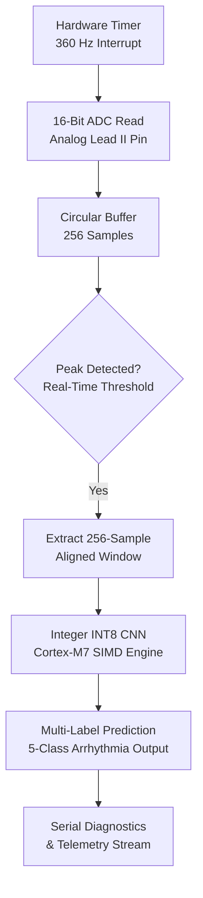

# Embedded Deployment (Arduino Giga R1 / STM32H7)

The primary target platform is the **Arduino Giga R1 WiFi**, powered by the high-performance **STM32H747XI dual-core microcontroller** (ARM Cortex-M7 @ 480 MHz and Cortex-M4 @ 240 MHz).

---

## 1. Embedded System Specifications

| Parameter | Specification |
|---|---|
| Microcontroller | STM32H747XI Dual-Core (Cortex-M7 @ 480 MHz + Cortex-M4 @ 240 MHz) |
| Flash Memory | 2 MB Dual-Bank Flash |
| SRAM | 1 MB internal SRAM (512 KB AXI SRAM + 128 KB ITCM + 128 KB DTCM + 288 KB SRAM1-4) |
| ADC Resolution | 16-bit SAR ADC (configured for ECG acquisition @ 360 Hz) |
| Inference Target Core | Cortex-M7 Core (CMSIS-NN integer SIMD instructions) |
| Latency Budget | < 10 ms per 256-sample window (Sampling interval = 2.77 ms) |
| Model Footprint | ~45 KB Flash (weights) + ~25 KB RAM (working activation buffers) |

---

## 2. Firmware Architecture

### Key Firmware Modules in `firmware/`:
1. `firmware/firmware/firmware.ino`: Main sketch with real-time Pan-Tompkins QRS detector (dynamic thresholding, derivative, squaring, moving window integrator, and refractory blanking), circular buffer, Z-score normalization, INT8 quantization, and inference execution.
2. `firmware/firmware/adc_acquisition.cpp` & `adc_acquisition.h`: 16-bit ADC sampling using STM32 AdvancedADC DMA @ 360 Hz with 810.5-cycle settling time.
3. `firmware/firmware/inference.cpp` & `inference.h`: Embedded INT8 multi-scale 1D-CNN inference engine ($k=3, 5, 7$), BatchNorm, SE channel attention, dual-pooling, and auxiliary RR timing ratio fusion executing against `weights.h`.
4. `firmware/firmware/signal_diagnostics.cpp` & `signal_diagnostics.h`: Diagnostic reporting and CSV telemetry streaming.
5. `firmware/tests/test_inference_golden.cpp` & `firmware/tests/golden_vectors/golden_vectors.h`: Bit-exact host C++ test harness validating C++ inference against PyTorch / Brevitas golden vectors.
