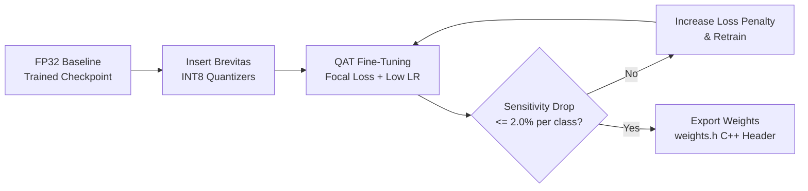

# Quantization-Aware Training & Deployment Export

To deploy deep neural networks to microcontrollers (MCU) without floating-point units (FPUs) or with tight power/memory budgets, weights and activations must be quantized to 8-bit integers (INT8).

---

## 1. Sensitivity-Preserving QAT (SP-QAT)

Quantization introduces precision loss that can degrade sensitivity on rare, life-threatening classes. Our **Sensitivity-Preserving QAT (SP-QAT)** pipeline enforces clinical bounds:



- **Quantization Backend**: [Brevitas](https://github.com/Xilinx/brevitas) (PyTorch library for uniform integer quantization).
- **Bitwidth**: Signed INT8 ($\text{int8} \in [-128, 127]$) for weights and activations.
- **Max Permissible Drop**: Sensitivity for any class must not drop by more than **2.0%** relative to the unquantized FP32 baseline.

---

## 2. Microcontroller Export Formats

Running the export script converts PyTorch weights and scale factors into deployment-ready artifacts:

```bash
python software/scripts/run_qat.py \
  --config software/config/config.yaml \
  --baseline software/outputs/checkpoints/best_model.pth
```

### 1. C++ Header (`weights.h`) for Microcontrollers
Exports flattened `static const int8_t` weight arrays, layer floating-point scales, bias arrays, BatchNorm statistics ($\gamma, \beta, \mu, \sigma^2$), and Squeeze-and-Excitation FC weights for direct inclusion in the firmware:
```cpp
// Auto-generated weights.h
#ifndef WEIGHTS_H
#define WEIGHTS_H
#include <stdint.h>

static const float layer_branches_0_conv1_scale = 3.1894e-03f;
static const int8_t layer_branches_0_conv1_weights[192] = { ... };
static const float layer_branches_0_bn1_gamma[32] = { ... };
...
#endif
```

### 2. Golden Vector Export (`golden_vectors.h`)
To ensure mathematical bit-exactness between PyTorch INT8 simulation and MCU C++ execution:
```bash
python software/scripts/export_golden_vectors.py \
  --config software/config/config.yaml \
  --checkpoint software/outputs/checkpoints/best_model.pth \
  --output firmware/tests/golden_vectors/golden_vectors.h
```
This enables the host C++ harness (`firmware/tests/test_inference_golden.cpp`) to verify MCU inference without physical hardware connected.
